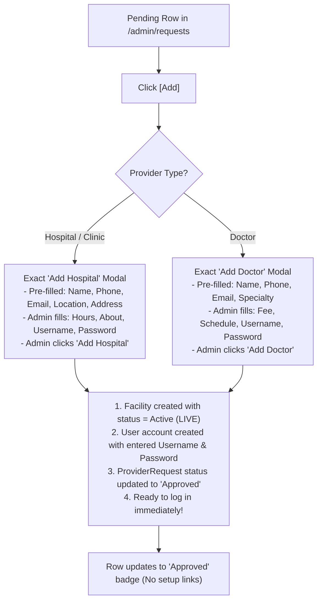

# Architecture & Implementation Plan: Direct Provisioning (No Setup Links) & 3-Action Workflow

**Document Status:** Ready for User Approval  
**Target Module:** Platform Administrator Portal (`/admin/requests`)  
**Components:** `AdminRequests.tsx`, `realAdminService.ts`, `backend/apps/onboarding`

---

## 1. Summary of Direct "Add" Workflow

Per your instructions:
1. **No setup links needed:** Eliminates all 72-hour invitation links, setup tokens, and the "Get Setup Link" button.
2. **Direct Modal (Same as Add Hospital / Add Doctor):** Clicking **`[Add]`** opens the exact same form modal as "Add Hospital" or "Add Doctor", containing all standard fields including **`username`** and **`password`**.
3. **Pre-filled from Application:** Known applicant details (name, contact person, phone, email, country, location, address) are automatically pre-populated into the modal.
4. **Immediate Go-Live:** When the admin fills any missing required fields and clicks the modal's **"Add"** button:
   - The Hospital, Clinic, or Doctor is created with status = **`Active`** (instantly **Live** on the platform).
   - The login account is created with the specified **`username`** and **`password`** (active and ready to log in immediately).
   - The application request is marked as **`Approved`**.
   - No setup link needed!

---

## 2. Table Action Buttons (`/admin/requests`)

### For Pending Applications:
Each pending row displays 3 clean action buttons:
1. **`[View]`** (Eye icon): Opens a read-only modal showing the applicant's complete submission (contact details, location, Google Maps link, submission timestamp).
2. **`[Add]`** (Plus icon, emerald): Opens the **exact same Add Hospital/Doctor modal** pre-populated with applicant data, including `username` and `password`.
3. **`[Reject]`** (X icon, rose): Opens a rejection confirmation modal to enter rejection notes.

### For Approved Applications:
- Shows clean status badge: **`Approved`** (green badge).
- The "Get Setup Link" button and credential delivery yellow notice banner are **removed**.

### For Rejected Applications:
- Shows status badge: **`Rejected`** (rose badge).

---

## 3. Issue Fix: "Submitted Date Shows Invalid Date"

- **Cause:** Backend returns `submitted_at`, while `realAdminService.ts` was reading `r.created_at`.
- **Fix:** Update `realAdminService.ts` mapper to accept `submitted_at || created_at` and format it nicely in `AdminRequests.tsx` (e.g. `Oct 31, 2026, 08:45 PM`).

---

## 4. Modal Specifications for `[Add]`

### Option A: Hospital / Clinic (Exact Match to `AdminHospitalsManage` Add Modal)
The modal contains the exact fields from `addForm`:
- **Identity:** `name`, `name_ar`, `facility_category` (`Hospital` | `Clinic` | `Wellness`), `type` (`hospital` | `clinic`)
- **Location:** `country`, `emirate`, `location`, `area`, `address`, `latitude`, `longitude`
- **Contact:** `phone_dial_code`, `phone`, `website`
- **Operations:** `operating_hours` (default: `Open 24/7`), `about` (bio)
- **Media:** `photo` (banner), `logo`
- **Insurance:** `insurance_plans` (multi-select)
- **Management Contact:** `manager_name`, `manager_phone`, `manager_email`
- **Live Login Credentials:**
  - **`username`** (Pre-filled with applicant's email or custom username)
  - **`password`** (Admin enters password for the facility manager)

*Result on Submit:* Facility created as **`Active`** (live), admin user created, request marked `Approved`.

---

### Option B: Doctor (Exact Match to `AdminDoctorsManage` Add Modal)
The modal contains the exact fields from Doctor `addForm`:
- **Identity:** `first_name`, `last_name`, `name`, `name_ar`, `gender`
- **Clinical:** `specialty`, `department`, `qualifications`, `special_interests`, `education`, `experience_years`
- **Affiliation:** `facilityId` (Select hospital/clinic if applicable)
- **Contact & Origin:** `country_of_origin`, `languages`, `phone_dial_code`, `contact_number`, `email`, `location`
- **Financial & Bio:** `consultation_fee` (AED), `about`, `photo`
- **Live Login Credentials:**
  - **`username`** (Pre-filled with doctor's email)
  - **`password`** (Admin enters password for the doctor)
- **Schedule:** `available_days`, `standard_slots`

*Result on Submit:* Doctor created as **`Active`** (live), user created, schedule initialized, request marked `Approved`.

---

## 5. End-to-End Workflow Diagram

---

## 6. Implementation Checklist

1. **Date Fix:** Fix `realAdminService.ts` date mapping (`submitted_at`).
2. **Table UI Cleanup:**
   - Remove the yellow setup link banner and the "Get Setup Link" button from `AdminRequests.tsx`.
   - Render 3 buttons for pending rows: `[View]`, `[Add]`, `[Reject]`.
3. **View Modal:** Simple detail modal for inspecting submitted info.
4. **Add Modal Integration:** Integrate the exact Hospital and Doctor Add Modal forms with pre-filled application data, username, and password fields.
5. **Backend Provisioning Integration:**
   - Call the provider creation endpoint directly or pass credentials and full fields to approve the request, activating the entity immediately.
6. **Reject Modal:** Capture rejection reason and set status to `rejected`