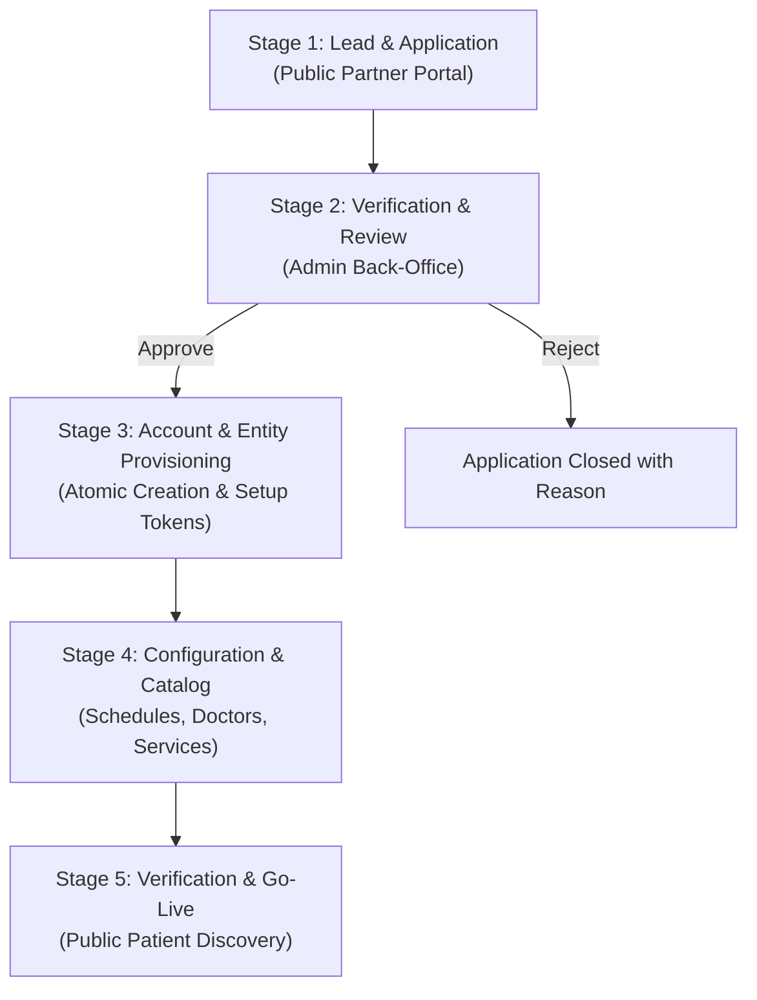
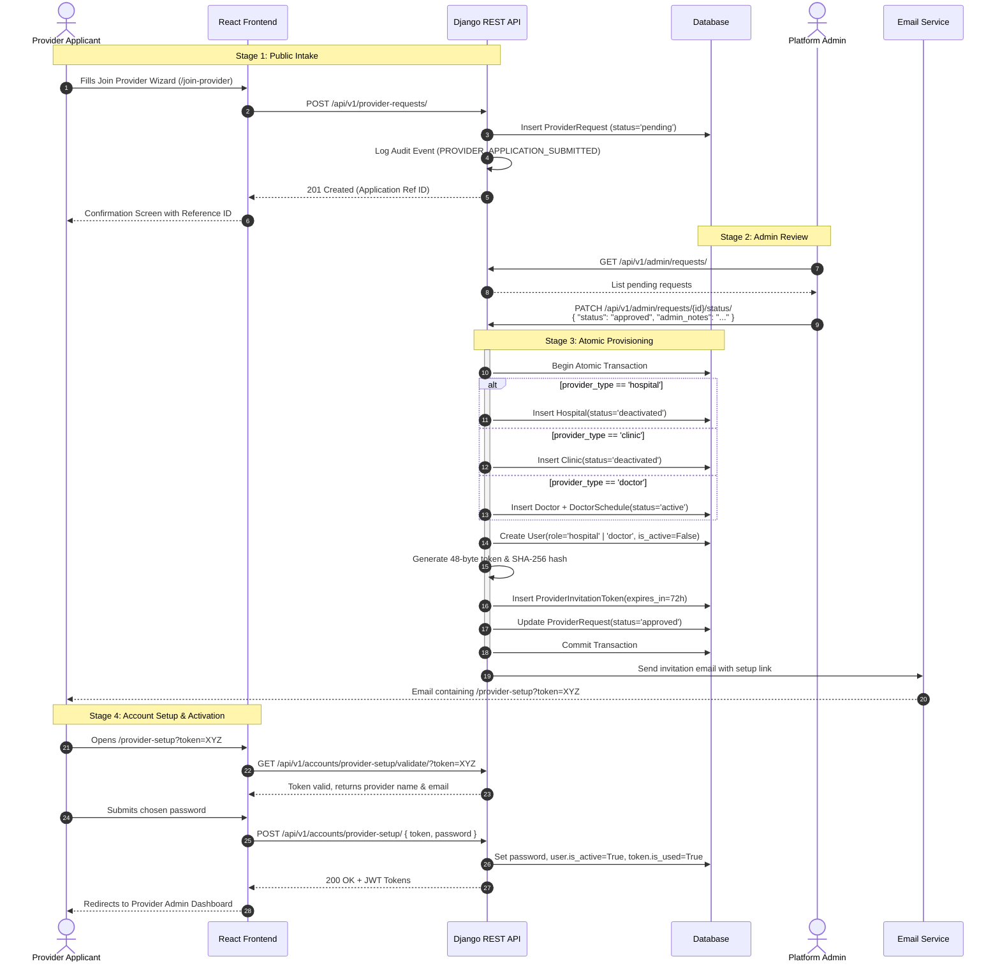

# Provider & Partner Onboarding Architecture Guide

## 1. Overview & Industry Context

In healthcare booking marketplaces (such as Zocdoc, Doctolib, Practo, and MeetADr), the **"Partner with Us" / Provider Flow** is the mechanism through which independent doctors, specialized clinics, and multi-specialty hospitals join the platform.

Unlike typical consumer self-signup flows, healthcare platforms require **gated, verified onboarding**:
1. Healthcare services carry legal, regulatory, and patient safety liabilities.
2. Credentials, facility licenses, and doctor identities must be vetted by administrators.
3. Access to administrative dashboards must follow secure, authenticated handoffs.

---

## 2. Standard Industry Lifecycle (5-Stage Model)

### Stage 1: Public Intake & Application
- Prospective providers (Hospital representatives, Clinic managers, or Individual Practitioners) submit an initial application.
- Captures practice name, provider type, primary specialties, contact information, geographic location, and map coordinates.

### Stage 2: Back-Office Screening & Review
- Operations and compliance teams verify:
  - Regulatory operating licenses.
  - Verification of contact person authenticity.
  - Geographic service coverage.
- Administrators record notes and approve or reject the request.

### Stage 3: Automated Entity & Account Provisioning
- Upon approval, the system atomically creates:
  - The provider entity (Hospital, Clinic, or Doctor profile) in a `Deactivated` or `Draft` status.
  - A dedicated administrator account with an unusable password.
  - A secure, single-use, time-expiring cryptographic setup token sent via email.

### Stage 4: Token Redemption & Profile Configuration
- The provider administrator clicks the setup link and chooses a secure password.
- The provider logs in to their dashboard and configures:
  - Operating hours and working shifts.
  - Staff doctor profiles and consultation fees.
  - Department services, amenities, and accepted insurance plans.

### Stage 5: Platform Activation & Public Discovery
- Once mandatory profile fields are completed, the entity status switches to `Active`.
- Patients can now discover the provider, view real-time availability, and book appointments.

---

## 3. MeetADr Implementation Details

In the **MeetADr** repository, this architecture is implemented across the Django backend and React frontend.

### 3.1 Database Models

Located in [`backend/apps/onboarding/models.py`](file:///c:/Users/AJNAS/Desktop/meetadr/backend/apps/onboarding/models.py):

#### `ProviderRequest`
Represents the partnership application.
- **`provider_type`**: `hospital` | `clinic` | `doctor`
- **`status`**: `pending` | `approved` | `rejected`
- **`name`** / **`name_ar`**: Facility or doctor display name.
- **`contact_person`**, **`contact_number`**, **`email`**: Contact channel.
- **`location`**, **`country`**, **`address`**, **`google_maps_url`**: Location data.
- **`reviewed_by`**, **`reviewed_at`**, **`admin_notes`**: Internal audit tracking.
- **`hospital`**, **`clinic`**, **`doctor`**: ForeignKeys linked to created entities upon approval.

#### `ProviderInvitationToken`
Cryptographic single-use setup token for provisioning.
- **`user`**: Associated user account.
- **`token_hash`**: SHA-256 hash of the 48-byte URL-safe raw token (raw token is never persisted in DB).
- **`expires_at`**: Lifetime timestamp (default 72 hours).
- **`is_used`**: Boolean flag tracking token consumption.

---

### 3.2 End-to-End Execution Flow

---

### 3.3 Key API Endpoints

| Endpoint | Method | Role | Description |
|---|---|---|---|
| `/api/v1/provider-requests/` | `POST` | Public | Submit new partnership application |
| `/api/v1/provider-requests/{id}/` | `GET` | Public | Read-only application status query (privacy-sanitized) |
| `/api/v1/admin/requests/` | `GET` | Platform Admin | Filterable list of all provider applications |
| `/api/v1/admin/requests/{id}/` | `GET` | Platform Admin | Detailed inspection of single application |
| `/api/v1/admin/requests/{id}/status/` | `PATCH` | Platform Admin | Approve or reject application (triggers provisioning) |
| `/api/v1/admin/requests/{id}/resend-invitation/` | `POST` | Platform Admin | Regenerate 72-hour setup token and resend invite email |
| `/api/v1/accounts/provider-setup/validate/` | `GET` | Public | Validate invitation token expiration and status |
| `/api/v1/accounts/provider-setup/` | `POST` | Public | Set password, activate user, and consume token |

---

### 3.4 Security & Robustness Invariants

1. **Zero Credential Leakage in Logs**:
   - Invitation tokens are generated via `secrets.token_urlsafe(48)`.
   - Only the SHA-256 hash is saved to the database. The raw token is only sent directly to the applicant via email or displayed once in the admin resend payload.
2. **Re-Approval Guard (Idempotency)**:
   - If an application is already `approved` or has linked facilities, any subsequent approval attempt returns HTTP 400 (`ALREADY_APPROVED`) to avoid duplicate records.
3. **Email Role Conflict Detection**:
   - If an existing user already exists with a conflicting role (e.g. `patient`), the approval aborts with HTTP 400 (`USER_EMAIL_CONFLICT`) instead of overwriting privileges.
4. **Initial Deactivated State**:
   - Approved clinics and hospitals default to `status='deactivated'` to ensure incomplete facilities are not exposed to patient search results before doctors and schedules are configured.
5. **Privacy Sanitization on Public Status**:
   - Public status queries (`GET /api/v1/provider-requests/{id}/`) expose only non-sensitive fields (`id`, `name`, `provider_type`, `status`, `submitted_at`), preventing scraping of admin notes, emails, or phone numbers.
